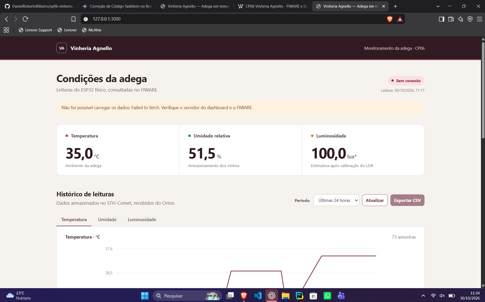

# CP06 — Vinheria Agnello: monitoramento IoT da adega



*Captura da interface enviada pela equipe. No momento desta imagem, a página mostra “Sem conexão” e mantém os últimos valores carregados; a imagem não comprova uma atualização ativa. A execução ponta a ponta validada está documentada na seção [Validação](#validação).* 

Projeto acadêmico de **Edge Computing & Computer Systems — Checkpoint 06**, com monitoramento de temperatura, umidade e luminosidade da adega. O ESP32 envia as leituras por Wi-Fi e MQTT ao FIWARE; um dashboard próprio em HTML, CSS e JavaScript consulta os valores atuais e o histórico, apresenta gráficos e permite exportar os dados em CSV.

**Versão documentada:** ESP32, DHT22 e LDR simulados no Wokwi. A montagem física com DHT11 do kit original foi adaptada para essa simulação. Os arquivos usados no Wokwi estão em [`CP06-Vinheria-Agnello/wokwi/`](CP06-Vinheria-Agnello/wokwi/); os manuais físicos e a pasta `firmware/` permanecem como referências da preparação original.

**Simulação:** [abrir projeto no Wokwi](https://wokwi.com/projects/479313364256822273).  
**Dashboard local:** [http://127.0.0.1:3000/](http://127.0.0.1:3000/), disponível enquanto o servidor Node.js estiver em execução.

## Equipe

| Integrante | RM |
| --- | --- |
| Daniel Roberto | 571746 |
| Jecky Cossio | 572226 |
| Felipe Pedrol | 569631 |

## Objetivo e requisitos implementados

O sistema acompanha condições ambientais que influenciam o armazenamento dos vinhos e permite consultar a evolução das leituras ao longo do tempo.

| Requisito do projeto | Implementação |
| --- | --- |
| Captura de temperatura e umidade | DHT22 conectado ao ESP32 no Wokwi |
| Captura de luminosidade | Saída analógica do módulo LDR no GPIO34 |
| Envio à internet por Wi-Fi | Rede virtual `Wokwi-GUEST` |
| Comunicação MQTT com o back-end FIWARE | Publicação UltraLight no tópico exclusivo do CP06 |
| Timestamp em cada leitura | Campo `ts`, em UTC, após sincronização NTP |
| Interface NGSIv2 e Smart Data Models | Entidade `Device` no Orion, com propriedades ambientais e identificação do sensor |
| Histórico de dados | Assinatura do Orion e armazenamento no STH-Comet |
| Dashboard customizado | HTML, CSS e JavaScript, servido por Node.js |
| Consulta e exportação do histórico | Gráfico, tabela, seleção de período e download CSV |

## Arquitetura

```text
DHT22 + LDR → ESP32/Wokwi → Wi-Fi → broker MQTT → IoT Agent UltraLight
                                                        ↓
                                                Orion / NGSIv2
                                                   ↓        ↓
                                              STH-Comet   valor atual
                                                   ↓        ↓
                                                 Node.js
                                                    ↓
                                          Dashboard no navegador

MyMQTT → assina o mesmo tópico MQTT para conferir as publicações do ESP32.
```

O MyMQTT permite observar as mensagens, mas não precisa encaminhá-las ao frontend. O servidor Node.js consulta o Orion para obter os valores atuais e o STH-Comet para recuperar o histórico. Essas consultas são feitas no servidor local, evitando depender de CORS no navegador.

## Pré-requisitos

- Node.js **18 ou superior** instalado no computador.
- Navegador com acesso ao [Wokwi](https://wokwi.com/projects/479313364256822273).
- Conexão de internet que permita acessar o gateway público do Wokwi e o servidor FIWARE.
- Back-end FIWARE já instalado e em execução: broker MQTT, IoT Agent UltraLight, Orion e STH-Comet.
- PowerShell, caso sejam utilizados os scripts de provisionamento e verificação.
- Git, caso o projeto seja obtido por clonagem; também é possível baixar o ZIP do GitHub.

O endereço preenchido no projeto é `3.135.234.101`. As portas usadas são **1883** (MQTT), **4041** (cadastro no IoT Agent), **1026** (Orion) e **8666** (STH-Comet). Os scripts deste repositório cadastram os recursos do CP06 em uma instalação existente; não instalam nem iniciam a infraestrutura FIWARE.

## Como executar a aplicação

### 1. Obter o projeto

```powershell
git clone https://github.com/DanielRobertoRibeiro/cp06-vinheria-agnello.git
cd cp06-vinheria-agnello
```

Se o projeto foi baixado como ZIP, extraia os arquivos e abra o terminal na pasta que contém este README e a subpasta `CP06-Vinheria-Agnello`.

### 2. Conferir o servidor FIWARE

O arquivo [`dashboard/config.json`](CP06-Vinheria-Agnello/dashboard/config.json) já contém o servidor, o serviço e a entidade usados na validação. Se a infraestrutura mudar, atualize `fiwareHost` nesse arquivo e `MQTT_HOST` no [`sketch.ino`](CP06-Vinheria-Agnello/wokwi/sketch.ino).

Para cadastrar ou verificar os recursos do CP06 em um FIWARE já instalado, execute na raiz do repositório:

```powershell
.\CP06-Vinheria-Agnello\provisionar-cp06.ps1 -Server '3.135.234.101'
```

O cadastro já foi realizado no servidor utilizado pela equipe. O script verifica os recursos existentes e cria apenas os que faltarem no serviço CP06. Após a primeira publicação do ESP32, execute-o novamente caso seja necessário acrescentar `controlledProperty` e `deviceCategory` à entidade criada pelo IoT Agent. Em outra infraestrutura, os parâmetros `OrionInternalUrl` e `SthNotifyUrl` devem corresponder aos nomes internos dos serviços.

### 3. Iniciar o ESP32 no Wokwi

1. Abra a [simulação do CP06](https://wokwi.com/projects/479313364256822273).
2. Clique em **Start the simulation** e aguarde a compilação, se solicitada.
3. Confira no Monitor Serial as mensagens `Wi-Fi conectado`, `MQTT conectado`, a leitura dos sensores e `Publicado FIWARE: t|...|h|...|l|...|ts|...`.
4. Mantenha a simulação em execução. Não abra duas instâncias com o mesmo Client ID MQTT.

Para reproduzir o circuito em um novo projeto ESP32 no Wokwi, substitua integralmente os arquivos `sketch.ino` e `diagram.json` pelos arquivos de [`wokwi/`](CP06-Vinheria-Agnello/wokwi/) e carregue também `libraries.txt`. As bibliotecas são **PubSubClient**, **DHT sensor library for ESPx** e **ArduinoJson**. A rede virtual é `Wokwi-GUEST`, sem senha, no canal 6.

### 4. Rodar o dashboard

Na **raiz do repositório**, execute:

```powershell
node .\CP06-Vinheria-Agnello\dashboard\server.js
```

Se o terminal já estiver dentro da pasta `CP06-Vinheria-Agnello`, o comando equivalente é:

```powershell
node .\dashboard\server.js
```

Este dashboard utiliza apenas módulos internos do Node.js; **não é necessário executar `npm install`**. O terminal deve informar:

```text
Dashboard CP06: http://127.0.0.1:3000
```

Abra [http://127.0.0.1:3000/](http://127.0.0.1:3000/) no mesmo computador. Deixe o terminal aberto enquanto usa a aplicação; **Ctrl+C** encerra o servidor. O endereço `127.0.0.1` é local ao computador e não representa uma hospedagem pública do dashboard.

### 5. Usar a interface

- Confira os cartões de temperatura, umidade e luminosidade e o horário da leitura.
- Alterne a variável do gráfico entre temperatura, umidade e luminosidade.
- Selecione o período: últimas 24 horas, 7 dias ou 30 dias.
- Use **Atualizar** para solicitar uma nova consulta; a página também consulta automaticamente a cada 15 segundos.
- Use **Exportar CSV** para baixar os registros históricos do período selecionado.
- No Wokwi, clique no DHT22 para alterar temperatura e umidade; clique no LDR para alterar a iluminação. Aguarde uma nova publicação e confira a mudança na página.

O firmware tenta enviar uma leitura a cada 10 segundos de simulação. O histórico disponível depende das publicações já recebidas e armazenadas no STH-Comet: escolher 30 dias não cria amostras para dias em que o sistema não estava coletando dados.

## Como conferir no MyMQTT

| Configuração | Valor |
| --- | --- |
| Broker / Host | `3.135.234.101` |
| Porta | `1883` |
| Usuário e senha | Em branco, conforme o servidor usado pela equipe |
| TLS / SSL | Desativado para essa porta |
| Tópico a assinar | `/ul/cp06vinheria571746/esp32cp06_571746/attrs` |

Conecte o aplicativo e faça o **subscribe** no tópico acima, sem adicionar dois-pontos no final. Uma mensagem efetivamente recebida durante a validação foi:

```text
t|18.0|h|65.0|l|999.5|ts|2026-10-30T14:02:26Z
```

Os campos `t`, `h`, `l` e `ts` correspondem a temperatura, umidade, luminosidade aproximada e timestamp UTC. O firmware aguarda um horário válido antes de publicar.

## Circuito e parâmetros dos sensores

| Componente | Ligação no ESP32 simulado |
| --- | --- |
| DHT22 VCC | 3V3 |
| DHT22 GND | GND |
| DHT22 SDA / DATA | GPIO15 |
| Módulo LDR VCC | 3V3 |
| Módulo LDR GND | GND |
| Módulo LDR AO | GPIO34 |

O módulo LDR do Wokwi já inclui o resistor de 10 kΩ. A conversão considera ADC de 12 bits, `rl10 = 50 kΩ` e `gamma = 0,7`. A tensão da saída analógica diminui quando a iluminação aumenta. O valor em lux é aproximado e sujeito à quantização do ADC.

O circuito inicia com **13 °C, 70% de umidade e 100 lux**. Essas são condições iniciais ajustáveis no simulador, e não leituras de um ambiente físico. A versão usa `DHTesp::DHT22` no GPIO15 e uma pausa de 10 ms no começo do loop; essa revisão produziu leituras válidas no teste.

## Modelo de dados e histórico

| Campo | Valor |
| --- | --- |
| `Fiware-Service` | `vinheria571746cp06` |
| `Fiware-ServicePath` | `/` |
| Chave UltraLight | `cp06vinheria571746` |
| Device ID | `esp32cp06_571746` |
| Entidade NGSIv2 | `urn:ngsi-ld:Device:vinheria-cp06-571746` |
| Tipo da entidade | `Device` |

| Campo MQTT | Atributo NGSIv2 | Tipo |
| --- | --- | --- |
| `t` | `temperature` | `Number` |
| `h` | `relativeHumidity` | `Number` |
| `l` | `illuminance` | `Number` |
| `ts` | `dateObserved` | `DateTime` |

A entidade inclui `controlledProperty` com as três propriedades ambientais e `deviceCategory` com o valor `sensor`, usando o modelo `Device`. O IoT Agent converte a mensagem UltraLight em atributos NGSIv2. Uma assinatura do Orion envia as alterações ao STH-Comet, responsável por armazenar o histórico.

O gráfico consulta até **300 amostras por variável** no período escolhido. O CSV consulta páginas do STH-Comet e exporta até **10.000 amostras por variável**, no formato `timestamp_utc,atributo,valor`. O horário exportado é o de recebimento no histórico (`recvTime`); `dateObserved` é o horário informado pelo ESP32 e pode diferir dele.

## Validação

O fluxo **Wokwi → Wi-Fi → MQTT → IoT Agent → Orion → STH-Comet → dashboard** foi validado em **30/10/2026**. Foram observados os valores iniciais de 13 °C, 70% e 100 lux e, após alterar os controles, 18 °C, 65% e 999,5 lux, com o LDR ajustado para 1.000 lux.

As mudanças chegaram ao Orion, ao histórico e aos cartões/gráfico do frontend. Um cliente MQTT independente recebeu a publicação no tópico da turma. O usuário também confirmou a assinatura no MyMQTT. Na captura da validação automatizada, o CSV continha 31 linhas de dados das três variáveis.

- [Screenshot da execução validada](docs/images/dashboard-validado.jpg).
- [Resultado das verificações automáticas](docs/evidencias/resultado-validacao.json).
- [CSV exportado do FIWARE durante o teste](docs/evidencias/historico-fiware.csv).

Para verificar novamente o back-end, execute na raiz do repositório:

```powershell
.\CP06-Vinheria-Agnello\verificar-cp06.ps1 -Server '3.135.234.101'
```

Confira os atributos da entidade e os registros `recvTime` / `attrValue` retornados pelo STH-Comet. Para demonstrar o projeto, mostre uma alteração nos sensores, uma mensagem com `ts` no Serial/MyMQTT, a atualização dos três cartões, a mudança no gráfico e o CSV exportado.

## Solução de problemas

| Sintoma | O que verificar |
| --- | --- |
| `Connection to IoT Gateway ... failed` no Wokwi | Acesso ao gateway público pela rede utilizada; reinicie a simulação após restabelecer a conexão. No teste da equipe, mudar para o acesso pessoal do celular liberou o acesso. |
| `Aguardando sincronizacao NTP` | Wi-Fi virtual e acesso à internet; aguarde o horário válido antes de procurar uma publicação. |
| Falha de leitura do DHT22 | Uso dos arquivos de `wokwi/`, biblioteca DHTesp, tipo DHT22 e conexão DATA no GPIO15. |
| MQTT desconecta repetidamente | Broker/porta e outra simulação usando o mesmo Client ID. |
| `Sem conexão` / `Failed to fetch` na página | Processo Node.js ainda em execução, endereço local correto e recarregamento da página após reiniciar o servidor. |
| Avisos de erro do Orion ou STH-Comet | Alcance das portas 1026/8666, configuração do servidor e disponibilidade do FIWARE. |
| Cartões com valores antigos | Compare o timestamp com o Serial e confira se o ESP32 continua publicando. |
| Histórico vazio ou CSV desabilitado | Primeiras amostras, assinatura histórica e período selecionado; o dashboard não gera dados fictícios para preencher o gráfico. |

## Organização dos arquivos

| Caminho | Conteúdo |
| --- | --- |
| [`CP06-Vinheria-Agnello/wokwi/`](CP06-Vinheria-Agnello/wokwi/) | Firmware, circuito e bibliotecas da simulação documentada |
| [`CP06-Vinheria-Agnello/dashboard/`](CP06-Vinheria-Agnello/dashboard/) | Servidor Node.js, configuração e interface HTML/CSS/JS |
| [`provisionar-cp06.ps1`](CP06-Vinheria-Agnello/provisionar-cp06.ps1) | Cadastro/verificação dos recursos CP06 no FIWARE existente |
| [`verificar-cp06.ps1`](CP06-Vinheria-Agnello/verificar-cp06.ps1) | Consultas ao IoT Agent, Orion e STH-Comet |
| [`docs/images/`](docs/images/) | Screenshot enviada pela equipe e captura da validação anterior |
| [`docs/evidencias/`](docs/evidencias/) | Resultado da verificação e CSV exportado |
| `CP06-Vinheria-Agnello/firmware/` e manuais físicos | Referências da montagem física originalmente preparada no kit |
| `referencias/` e arquivos ZIP do kit | Material de continuidade; para executar esta versão, siga este README e a pasta `wokwi/` |

O firmware Wokwi também contém espelhamento de telemetria para um broker público de demonstração e uma ponte opcional de consultas HTTP. O dashboard desta pasta consulta o FIWARE diretamente; esses recursos auxiliares não são necessários para executá-lo. A ponte não foi utilizada na validação final.

## Referências técnicas

- [Wi-Fi do ESP32 no Wokwi](https://docs.wokwi.com/guides/esp32-wifi).
- [Sensor DHT22 no Wokwi](https://docs.wokwi.com/parts/wokwi-dht22).
- [Módulo LDR no Wokwi](https://docs.wokwi.com/parts/wokwi-photoresistor-sensor).
- [Documentação do Orion Context Broker](https://fiware-orion.readthedocs.io/).
- [Smart Data Models — Device](https://github.com/smart-data-models/dataModel.Device).
